<p align="center">
  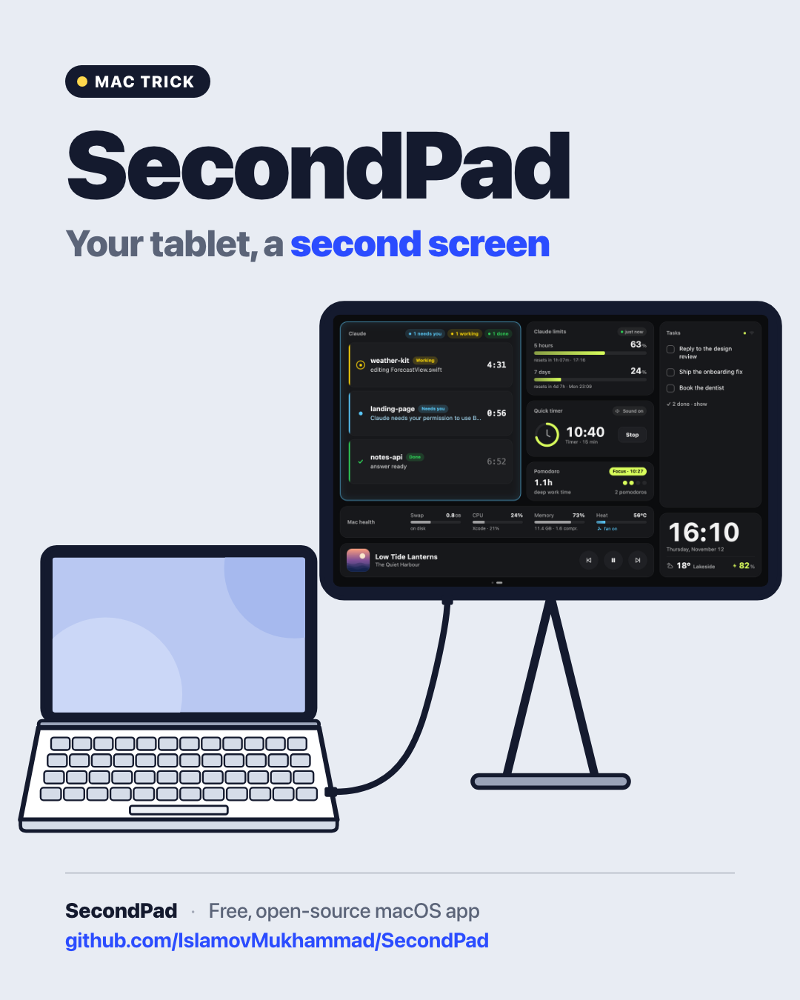
</p>

# SecondPad

[](https://github.com/IslamovMukhammad/SecondPad/actions/workflows/ci.yml)

**Turn an Android tablet into a second screen for your Mac: Claude Code sessions, plan limits, a quick timer, Pomodoro deep focus, tasks, Mac health and Spotify.**

A free, open-source macOS menu-bar app. The Mac collects everything; the tablet, plugged in over USB, shows a
full-screen dashboard and sends a few taps back.

> Not affiliated with or endorsed by Anthropic. Claude and Claude Code are trademarks of Anthropic.

## Features

### Main page

| Card | What it shows |
|---|---|
| **Claude** | One row per Claude Code session: state (Working / Needs you / Done / Failed), project, current step and a timer. Summary chips such as "1 needs you · 2 working". The card glows calmly while a session needs you. |
| **Claude limits** | 5-hour and 7-day plan usage with reset times and how fresh the numbers are. |
| **Quick timer** | Presets 5/10/15/20, −/+ 1–60 min, sound on/off. The tablet and the Mac's menu bar drive the same timer; at the end the screen flashes and a chime plays. |
| **Pomodoro** | Today's deep work time and pomodoros; tap it to open Deep Focus. |
| **Tasks** | Today's quick list: type tasks in the Mac's menu bar, tick them on the tablet (with a 4-second Undo). Unfinished tasks carry over to the next day. |
| **Mac health** | Swap, CPU, Memory and Heat (with the fan). CPU above 85 % or heat above 95 °C lights the card's edge; memory stalls make Swap breathe purple. Tap a segment for a 5-minute detail sheet. |
| **Now playing** | Spotify: cover, title, artist, ⏮ ⏯ ⏭, and a full-screen Now Playing view. Controls go to Spotify only, never to other apps. |
| **Clock** | Time, date, weather (Open-Meteo) and your Mac's battery. |

### Deep Focus page

A Pomodoro screen built for focus: a big timer, "You're in <app>" turning orange the moment you switch to a
distraction, a minute-by-minute on-task / distracted strip, Purity, Focus broken, Distracted, "Where attention
went", a week chart, and a breathing guide during breaks (box, 4-7-8 or cyclic sighing). Swipe with two fingers
to switch pages. App tracking runs **only while a focus period runs**.

### StandBy clock

When your Mac's screen saver starts, the screen locks, the displays sleep or the Mac goes to sleep, the tablet
turns into a big bedside clock, with the most urgent Claude state and the Pomodoro underneath. It also appears if
the Mac has been gone for 15 seconds. A tap hides it; it moves a few pixels every minute against burn-in. You can
turn it off in Settings.

StandBy can use your Mac's own SF Pro Rounded for its digits: SecondPad reads it from macOS at runtime and sends
it to your tablet over the cable (no font is bundled). Apple licenses its fonts for Apple platforms, so this is off
by default (Settings → Tablet).

### On the Mac

A menu-bar window with a "New task for today" field, the Pomodoro and Quick timer controls, and buttons to open
the dashboard on the tablet or in a browser. Settings has the Claude Code hooks, Live usage, Pomodoro lengths, the
breathing pattern, weather location and the chime.

## Screenshots

**Main page**

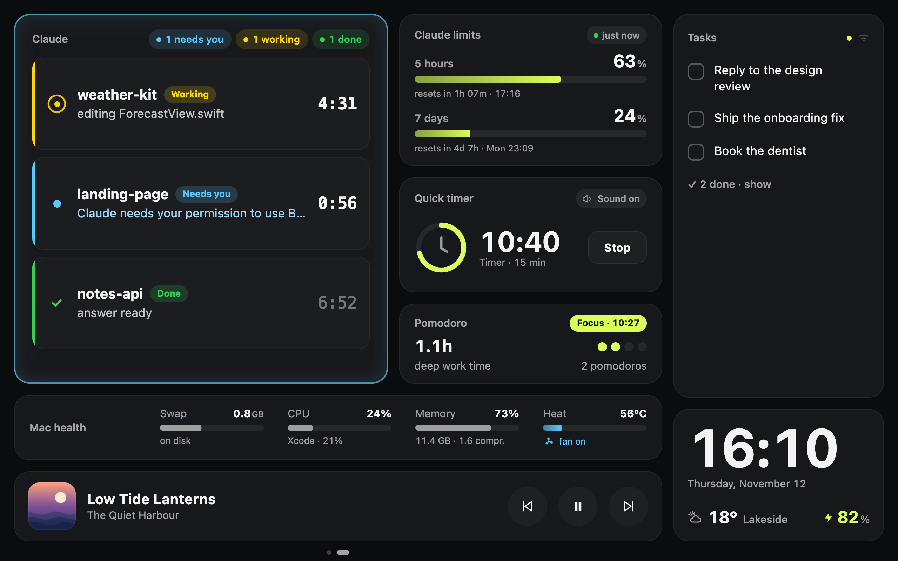

**Deep Focus**

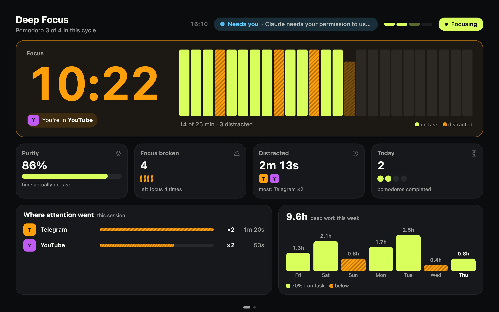

| | |
|---|---|
| **CPU detail sheet**<br>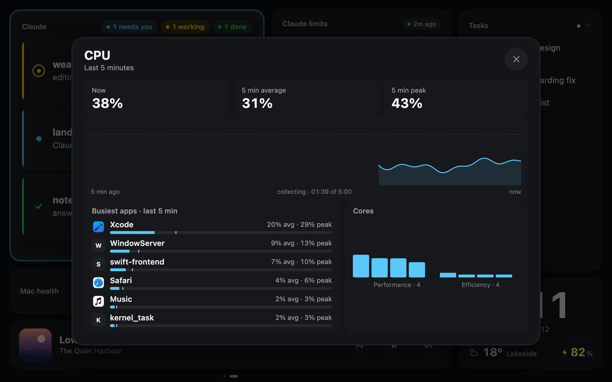 | **Heat detail sheet**<br>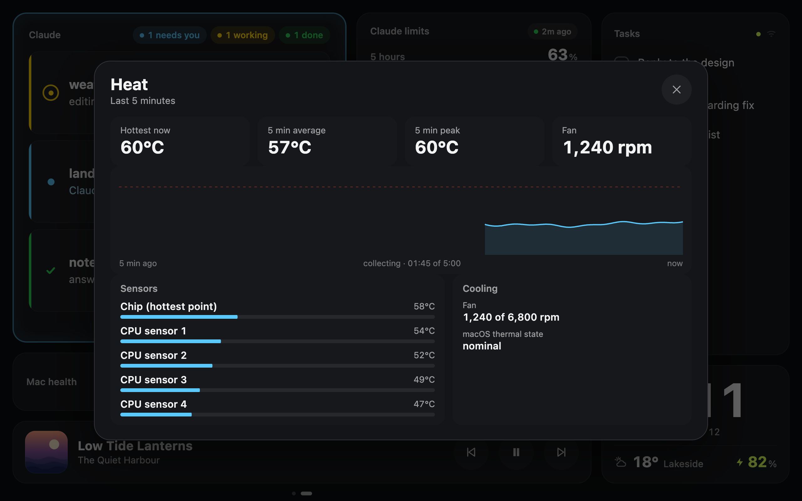 |
| **Now Playing**<br>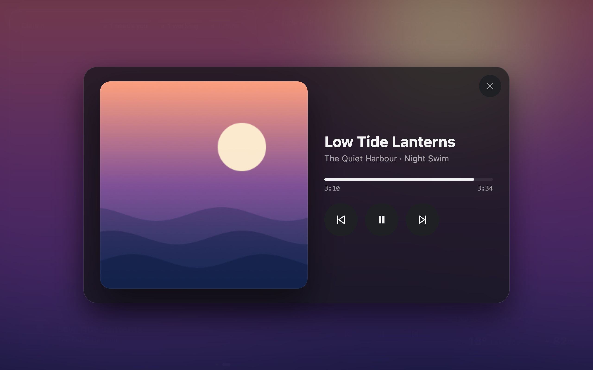 | **Menu-bar window**<br>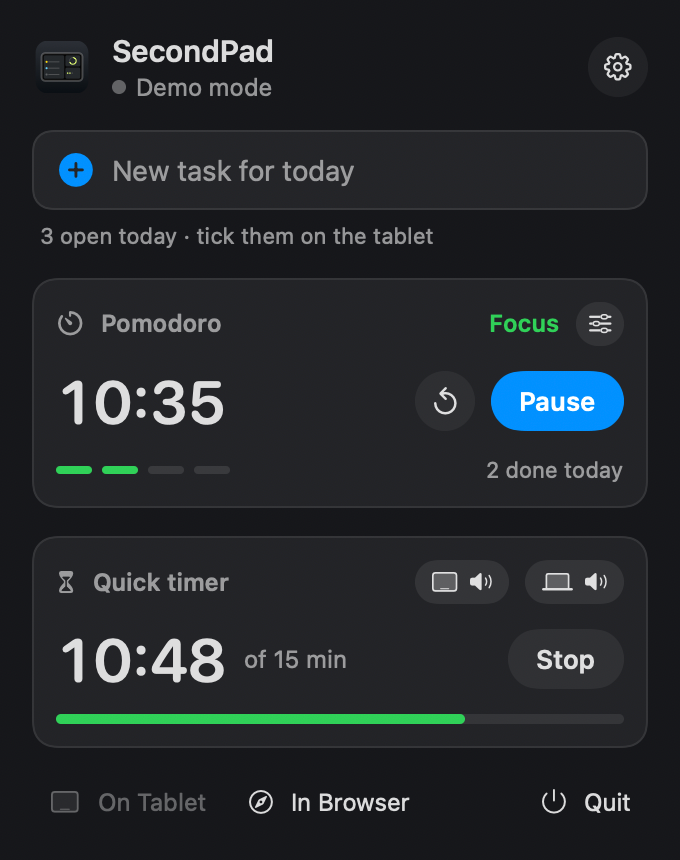 |
| **StandBy clock**<br>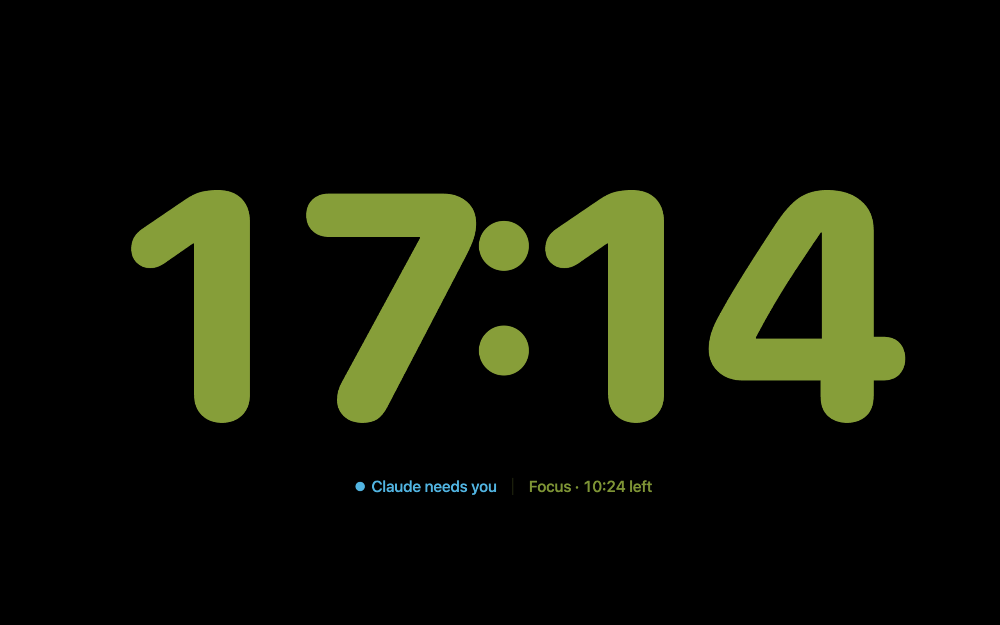 | |

**Worst case**: the same pages with deliberately extreme test data (100 % CPU, 99 °C, critical memory, long
names, 30 tasks) to show the warnings and how long text is handled.

| | |
|---|---|
| 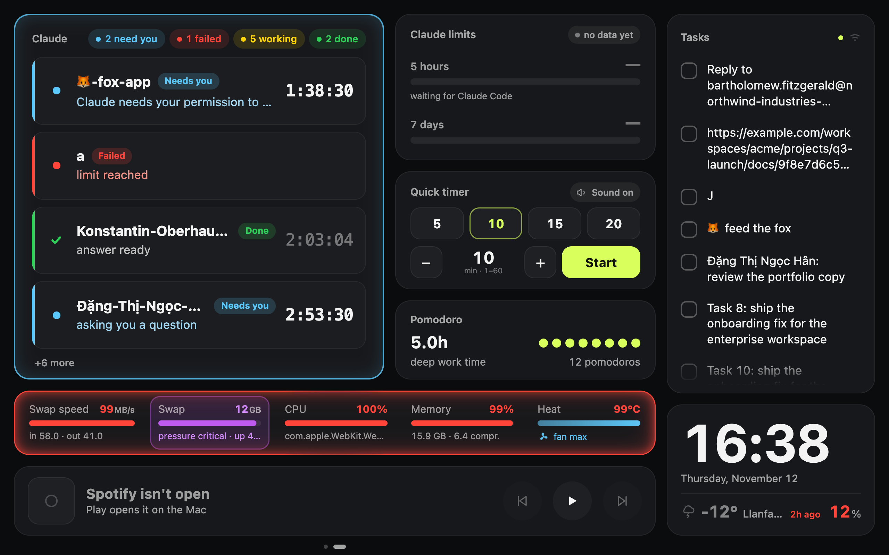 | 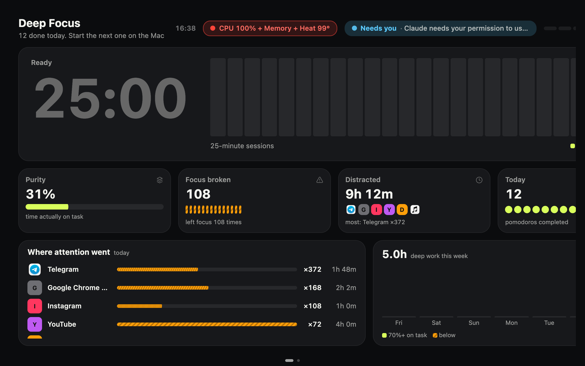 |
| 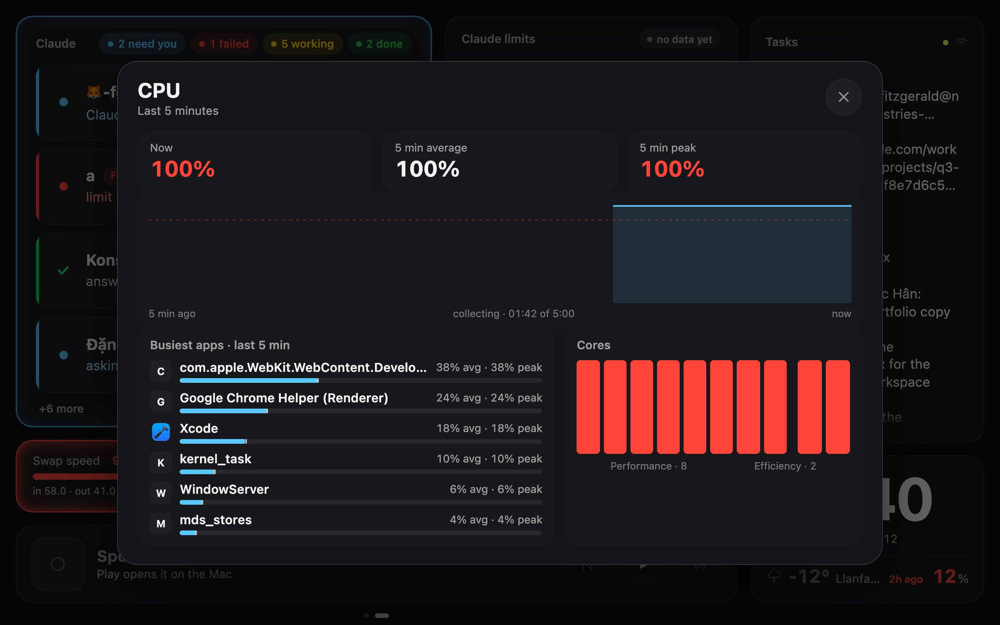 | |

All screenshots use the app's demo mode with made-up data.

## How the tablet connects

SecondPad serves the dashboard from your Mac at `http://127.0.0.1:8770`, **only on this Mac** (never on your
network). An **Android tablet connected by USB** reaches it through `adb reverse tcp:8770 tcp:8770`, so the
tablet's own `127.0.0.1:8770` leads to the Mac. When you plug the tablet in, SecondPad opens the page in the
tablet's Chrome once; Chrome can also install it as an app.

You need:

1. `adb` (Android platform tools), for example `brew install --cask android-platform-tools`.
2. **USB debugging** turned on in the tablet's developer options, and the Mac allowed on the tablet.

SecondPad only creates and re-creates its own `reverse` tunnel. It never restarts the adb server or touches
other apps' tunnels. You can also open the dashboard on the Mac itself (menu bar › **In Browser**).

## Claude Code hooks and the shared statusLine

The Claude card and the limits card are fed by Claude Code. Nothing changes until you click
**Settings › Claude Code › Install Hooks**. It then:

- adds one hook per event to `~/.claude/settings.json`, keeping your other hooks, and saves
  `~/.claude/settings.json.secondpad-backup` first;
- writes a small hook script to `~/Library/Application Support/SecondPad/` that sends only the event, session id,
  folder, tool name and a short hint (never your prompts, files, full commands or tool output) over a private Unix
  socket with a per-install token;
- sets up Claude Code's **statusLine** so the plan limits reach SecondPad:
  - if you had none, SecondPad's script is used; it prints nothing;
  - if you **already have one**, it is **shared**: SecondPad saves your command (file 0600), and its script first
    sends the limits, then runs your command with the same input and prints its output, so your status line
    looks as before.

**Remove Hooks** removes only SecondPad's entries and **restores your original statusLine exactly**.

### Live usage (optional, off by default)

If you'd rather not use the statusLine, or use the Claude desktop app, turn on **Live usage**. SecondPad then
reads Claude Code's login from the Keychain, keeps the token **in memory only** (never written or logged), and
asks `api.anthropic.com` for your 5-hour and 7-day usage about every 5 minutes. While it is off, the Keychain is
never read.

## Privacy and security

- **Everything stays on your Mac and the tablet.** No analytics or telemetry.
- **The web server** listens on 127.0.0.1:8770 only. It refuses any `Host` other than `127.0.0.1:8770` /
  `localhost:8770` (no DNS rebinding), and the WebSocket must come from the page's own origin.
  The live data, the commands and the icons also need a **per-install key**: 32 random bytes in
  `~/Library/Application Support/SecondPad/web-token` (0600). SecondPad opens the page with that key, the page keeps
  it, and requests without it are refused, so other programs or other users on the Mac can't read the dashboard
  or send commands.
  Responses use a strict Content-Security-Policy, `nosniff`, `no-store` and `no-referrer`.
- **What the tablet can do on the Mac** is a short fixed list: Spotify play/pause/skip, the quick timer, ticking a
  task, and answering the end-of-Pomodoro question. Nothing on the tablet can run code, open files or URLs on the Mac.
- **Claude Code hooks** use a Unix socket in a folder only you can open (0700; socket 0600), a per-install token,
  and a minimal payload. Transcript files are read only from `~/.claude/projects`, as regular files.
- **Focus tracking** (only while a Pomodoro focus period runs): the front app, and the **domain** of Chrome's
  active tab (never the full URL, never in incognito). Its history stays in `~/Library/Application Support/SecondPad/`.
- **Network requests**: the weather from Open-Meteo (no key; your city is looked up once, then only coordinates),
  Spotify's cover art from Spotify's own CDN, the icons of a fixed list of known sites (https, re-drawn by the
  Mac), and Live usage if you turn it on. The tablet never fetches anything from the internet itself.
- **Location** is used only when you press "Use This Mac's Location", rounded to about 1 km.

## Requirements

- macOS 26 or later
- An **Android tablet** with Chrome, connected by **USB**, and `adb` on the Mac
- Optional: Claude Code, Spotify, Chrome (for focus tracking)
- Xcode 26 / Swift 6.2 toolchain to build

## Build from source

There is no prebuilt download. Build it yourself in a minute:

```bash
git clone https://github.com/IslamovMukhammad/SecondPad.git
cd SecondPad
./build.sh --install   # builds, copies to /Applications and launches
```

`./build.sh` alone puts the app in `build/SecondPad.app`. Run the tests with `swift test` and
`node --test Tests/web/logic.test.js`. Try it without a tablet: `build/SecondPad.app/Contents/MacOS/SecondPad --demo`,
then menu bar › **In Browser**.

## How it works

| Part | Where |
|---|---|
| Web server, WebSocket, access rules | `Sources/SecondPad/Server/` |
| The dashboard (HTML/CSS/JS, served from the app) | `Resources/Web/` |
| USB link (`adb reverse`) | `Sources/SecondPad/Tablet/TabletLink.swift` |
| Claude Code hooks, statusLine sharing, socket receiver | `Sources/SecondPad/Claude/` |
| Plan limits and Live usage | `Sources/SecondPad/Usage/` |
| Pomodoro, focus tracking, history | `Sources/SecondPad/Focus/` |
| CPU, memory, swap, battery, temperature (SMC, read-only) | `Sources/SecondPad/System/` |
| Quick timer and chime | `Sources/SecondPad/Timers/` |
| Spotify and site icons | `Sources/SecondPad/Media/` |
| Weather (Open-Meteo) | `Sources/SecondPad/Weather/` |

## Known limitations

- Android over USB only (adb + USB debugging). No Wi-Fi mode and no iPad.
- Focus tracking reads tabs from Chrome only; Safari and Firefox count as "other" during focus.
- Heat and fan come from the SMC; on a Mac without readable sensors Heat shows "—".
- Plan limits from the statusLine arrive only with terminal Claude Code on Pro/Max, after its first answer. Live
  usage relies on an undocumented endpoint that may change.
- The page key is passed to adb on the command line when SecondPad opens the page on the tablet; other users
  on the same Mac could see it briefly in the process list.
- The tablet uses its own system font (Roboto on Android).
- English UI only.

Bug reports and pull requests are welcome.

## Credits

Originally built as part of the author's personal desk companion app.

## License

[MIT](LICENSE) © 2026 Muhammad Islamov

## Follow

- GitHub: [@IslamovMukhammad](https://github.com/IslamovMukhammad)
- Telegram: [t.me/infinitwo](https://t.me/infinitwo)
